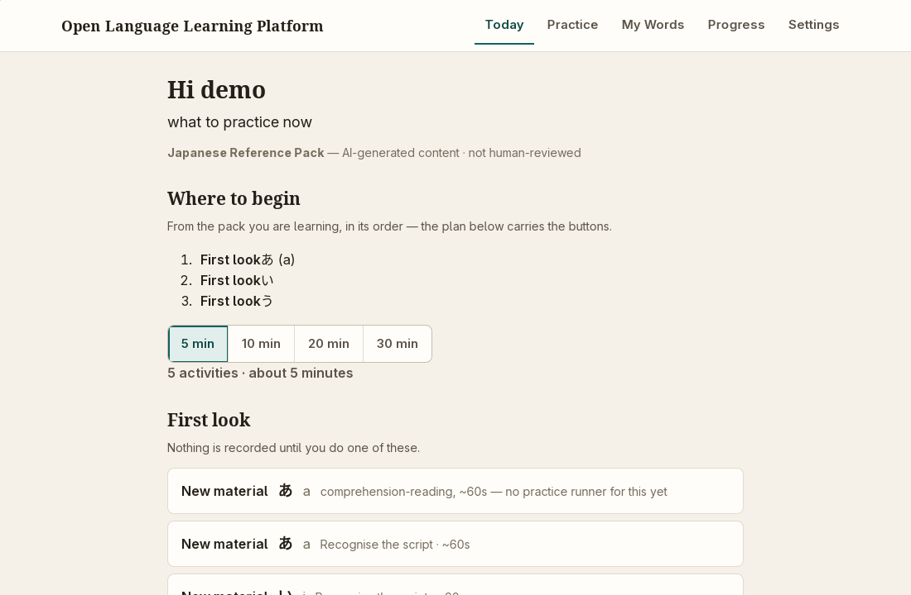

# Open Language Learning Platform

A local-first, open-source language-learning application. Progress is measured as **what you can understand and do in the target language** — situations you can handle, words you can use — rather than lessons completed, points earned, or days in a row logged. The first reference languages are **Japanese** and **Russian**; the engine is language-independent and driven by installable language packs.

Working title. The product will be renamed after a naming/trademark check.

**Status: public alpha, 2026-10-13.** The desktop app runs on **Linux**, which is the only platform we have tested. Windows and macOS installers are built by CI but untested: a platform becomes *community-confirmed* only when a human who actually ran that build files a runtime report (`docs/platform/PLATFORM_REPORTS.yaml`, ADR-0015). Mobile and web are not built.

---

## Try it (Linux, no build required)

Download the package for your distro from the [latest release](https://github.com/Berzerker5653/open-language-learning/releases/tag/open-language-learning-platform-0.4.0-alpha.1):

| file | size | what it is |
| --- | --- | --- |
| `open-language-learning-platform_0.4.0-alpha.1_amd64.deb` | 12 MB | Debian/Ubuntu package, base app |
| `open-language-learning-platform_0.4.0-alpha.1_amd64.AppImage` | 73 MB | single executable for any x86-64 distro, base app (run `chmod +x`, then launch) |
| same names with `_amd64-aligner` | 84 MB / 145 MB | the same app plus the built-in speech aligner (whisper.cpp + its tiny model), so pronunciation feedback works with no model download |

What is downloadable is the **0.4.0-alpha.1 publication**. The in-app catalog serves the **0.4.1 corrected language packs** (published 2026-10-16; `catalog/packs.json` pins both archives by size and SHA-256), so a fresh install picks the corrected packs regardless of which app artifact you start from. `main` has moved past the app artifact: fixes and content changes are merged there but no newer artifact has been published, so a source checkout and the download are deliberately different builds. The next-artifact decision is an owner action (O-06), not something CI performs.

Start the app, then **Settings → Language packs → install** and pick Japanese or Russian. That fetches the published pack (~320 MB each, audio included) from the in-app catalog — no configuration, no account, nothing to compile (ADR-0027). You can instead import a `.lpk` file you were given. Once a pack and, if you want speech, the aligner build are installed, the core loop runs fully offline; disconnect and it keeps working.

The first launch walks you through a name, the pack, and a microphone choice. Installing a reference pack is not instant — it unpacks about 336 MB of audio, and how long that takes is a property of the machine, not of the app: on a 2-core CI runner the stage was still unfinished after 240 s, so give it time on a modest machine. The notice names the stage the engine is actually on, so a waiting screen is not a stuck one.




That banner is deliberate. It is the app's own statement of the language pack's review posture, and it appears wherever content has not had a qualified human review — the app never implies review that did not happen.

## What is in the app

Five destinations on the sidebar — **Today** (what to practise now), **Practice**, **My Words**, **Progress**, **Settings** — and Practice opens a hub of eight modes: **Pronunciation**, **Speaking**, **Writing**, **Scenarios**, **Shadowing**, **Reading**, **Kanji** (Japanese), **Placement** (finding your starting level). Speaking and listening are treated as separate skills from reading: recognising a word never marks you as able to say or understand it.

Reference-pack coverage, measured on this tree on 2026-10-14: `ja-JP` 75 goals / 792 units / 4,587 activities, `ru-RU` 60 goals / 818 units / 3,248 activities, spanning on-ramp through B2 in both languages. Every reference in the unit graph resolves — `audit-curriculum` fails the build on a dangling link, so the zero is a gate, not an estimate.

## What it deliberately does not do

- **No streaks, no XP-as-progress.** Nothing in the product rewards activity for its own sake. If an engagement metric can be maximised without learning, that is treated as a defect to fix.
- **No account, no required service.** The core path is offline. Microphone audio stays on your machine; anything that could upload is an optional provider that must show a privacy notice before first use.
- **No accuracy claims it cannot support.** There is no human speech-calibration dataset for this project, so pronunciation feedback is *guided only* and never presents itself as a measured score (ADR-0017).
- **No speech synthesis in-app** (ADR-0024): pack audio is authored into the language pack, not generated on your machine.

## Honest limits right now

Read this before recommending it to someone still learning.

- **Every piece of pack content is AI-drafted and has never had a qualified human review.** All 75/75 Japanese and 60/60 Russian goals are `review_status: draft`; no content record anywhere is `validated` or `verified`. The app never claims otherwise, and `docs/18_PUBLIC_CLAIMS_AND_SCOPE.md` forbids surfaces that imply review which did not happen.
- **Speech feedback is uncalibrated** — useful for practice, not a measurement.
- **Open release gates** (`state/task-state.json`, 9 of 67 still required for `REL-001`): assistive-technology audit (ACC-001), performance tiers (PERF-002), platform parity (PLAT-001), security and privacy audit (SEC-001), the EDRDG/JMdict attribution the licence owes on an app surface (JA-KANJI-ATTRIBUTION-001), depth in the thin CEFR bands (JA-A2-001, JA-B1-001, JA-B2-001 — the scaffolding exists, the B1+/B2 coverage claims do not, and qualified human review is the only thing that can earn them), and the release gate itself (REL-001). These are tracked in `tasks/KANBAN.md`.
- **Windows and macOS are untested**, and the app is Linux-only in practice today.

## Contributing

Three ways that actually move the release gates:

1. **File a platform runtime report** — run the app on Windows, macOS, or a Linux distro you know and use the *Platform runtime report* issue template. Each report feeds `docs/platform/PLATFORM_REPORTS.yaml`, which PLAT-001 reads.
2. **Review language-pack content** — start at `CONTRIBUTING.md` ("Reviewing language-pack content"); reviewer kits and worklists are in `languages/ja-JP/review/` and `languages/ru-RU/review/`. Human review is the only route to a `validated`/`verified` trust state, and no agent may perform it.
3. **Fix code** — `CONTRIBUTING.md` covers the setup and the gates a change must pass.

Report security issues privately through GitHub's *Report a vulnerability* on the Security tab, per [`SECURITY.md`](SECURITY.md) — not through a public issue.

### Build from source

The toolchain is pinned, so a fresh clone needs exactly three things: **Rust** (`rust-toolchain.toml` pins 1.97.1 with rustfmt and clippy, which `rustup` installs automatically), **Node ≥ 26**, and the pinned package manager — `packageManager` says `pnpm@12.8.1`, and Node 26 no longer ships corepack, so:

```sh
npm install --global pnpm@12.8.1
pnpm install --frozen-lockfile
```

Desktop system packages (Debian/Ubuntu): `libwebkit2gtk-4.1-dev libssl-dev libayatana-appindicator3-dev librsvg2-dev`. On Arch without sudo, `scripts/setup-tauri-sysroot.sh` builds a user-local webkit2gtk sysroot instead.

Launch the app you are reading about — it builds a debug binary if one is missing and serves the UI itself:

```sh
scripts/launch-preview.sh
```

The gates every change has to pass:

```sh
pnpm fmt:check && pnpm lint && pnpm typecheck && pnpm test   # web layer
cargo test --workspace                                       # engine, storage, shell
cargo run -q -p lts-langpack-cli -- test languages/ja-JP      # pack conformance
```

Reference-pack audio is deliberately not in git (ADR-0016). The committed `media/manifest.jsonl` records what every asset is; `scripts/fetch-pack-audio.sh` restores the published `.wav` bytes from the release archives (what CI does), and `scripts/generate-pack-audio.py` can regenerate them from scratch. A pack whose audio is incomplete is refused at build and at install (ADR-0024), never silently shipped silent.

The specification itself has a validator, useful when you change docs or schemas:

```sh
python3 -m venv .venv && . .venv/bin/activate
python -m pip install -r tools/requirements.txt
python tools/validate_handoff.py
```

## Product principles

These are non-negotiable project decisions, recorded as ADRs and enforced by the release gates:

1. No streak mechanics; meaningless activity must never be rewarded.
2. Speech, listening, reading and writing are independent competencies.
3. Language packs are a first-class public interface: a competent human or AI can build a candidate pack from the published spec without editing application code (`docs/04_LANGUAGE_PACK_SPEC.md`).
4. AI-generated content is never trusted merely because it parses. Provenance, tests, quality gates and review states are mandatory.
5. Local-first and privacy-first; online services are optional providers, never dependencies.
6. The language is the gameplay mechanic — progress unlocks situations and capabilities, not XP.
7. No vendor or model lock-in: ASR, alignment, pronunciation analysis, storage and tutoring are provider interfaces.
8. An offline core path: installed curriculum and downloaded speech capability work with no account and no connection.
9. Accuracy over content velocity — wrong instruction is a critical defect.
10. The repository is the durable memory: no project state lives in chat history.

## Where to read more

| document | contents |
| --- | --- |
| `docs/00_MASTER_SPEC.md` | authoritative product contract |
| `docs/01_PRODUCT_AND_UX.md` | user experience, game structure, anti-streak rules |
| `docs/02_LEARNING_SCIENCE.md` | pedagogical model and evidence boundaries |
| `docs/03_CURRICULUM_AND_MASTERY.md` | typed curriculum graph, learner model, mastery and scheduling |
| `docs/04_LANGUAGE_PACK_SPEC.md` | public language-pack architecture |
| `docs/05_SPEECH_SYSTEM.md` | local ASR, alignment, pronunciation/prosody feedback |
| `docs/06_JAPANESE_REFERENCE.md` | Japanese-specific reference requirements |
| `docs/07_TECHNICAL_ARCHITECTURE.md` | software architecture |
| `docs/08_DATA_AND_PRIVACY.md` | storage, privacy, sync boundaries, threat model |
| `docs/09_TESTING_AND_ACCEPTANCE.md` | quality gates and definition of done |
| `docs/10_LICENSING_AND_PROVENANCE.md` | licences, source tracking, dataset rules |
| `docs/11_ACCESSIBILITY_AND_LOCALIZATION.md` | accessibility and UI localisation |
| `docs/12_OBSERVABILITY_AND_RESEARCH.md` | privacy-safe metrics and efficacy evaluation |
| `docs/13_RELEASE_AND_DISTRIBUTION.md` | builds, models, packs, release channels |
| `docs/14_FAQ_AND_DECISIONS.md` | anticipated product and engineering questions |
| `docs/15_AUTONOMOUS_DEVELOPMENT.md` | how the coding agents execute unattended |
| `docs/16_CONTENT_AUTHORING_AND_REVIEW.md` | review and trust-promotion protocol |
| `docs/17_SPEECH_BENCHMARK_PLAN.md` | provider and calibration protocol |
| `docs/18_PUBLIC_CLAIMS_AND_SCOPE.md` | claim and completeness gates |
| `docs/19_PROJECT_FILE_ARCHITECTURE.md` | file ownership boundaries |
| `docs/20_CONTRIBUTOR_REVIEW_PACKET.md` | the five-item packet for a one-change contribution |
| `docs/21_HUMAN_REVIEW_RUNBOOKS.md` | the three human-only gates as executable runbooks: assistive-technology pass, hands-on product pass, qualified language review |
| `docs/SOURCES.md` | research and source registry |

Living state: `tasks/KANBAN.md` (what is being worked on and what is blocked), `state/task-state.json` (the release ledger), `docs/adr/` (every architectural decision and its status).

### For a coding agent

Read in this order, and do not load every document per task:

1. `START_HERE_OMP.md`
2. `AGENTS.md`
3. `docs/00_MASTER_SPEC.md`
4. `tasks/ROADMAP.yaml`
5. only the documents listed by the selected task's `read_first` field

## Scope and licence

The architecture targets CEFR A1–C2-like capability ranges; the first public-quality Japanese release is meant to be complete through independent-user/B2 communicative coverage, with the pipeline able to continue into C1/C2. Advanced content must never be faked to imply completeness. The default implementation target is the desktop release candidate `REL-001`; the remaining human gates (security review, privacy review, assistive-technology audit, hands-on test pass) belong to the project owner and cannot be self-certified by an agent.

Language-pack content is licensed per pack, and the declaration lives in the pack itself: `ja-JP` declares `CC-BY-SA-4.0` — its lexicon and kanji layers descend from the EDRDG JMDict dictionary, which is share-alike — and `ru-RU` declares `CC0-1.0`, because its only non-original source is a reference-only verification pointer (see the `license:` block in `languages/*/manifest.yaml`). Per-asset provenance and source licences live in `languages/*/licenses.jsonl`, the rules those records must satisfy in `docs/10_LICENSING_AND_PROVENANCE.md`, and `audit-licenses` now checks that a pack never declares something more permissive than the sources it contributes from. The application and engine source is Apache-2.0 (`LICENSE`). Third-party binaries actually bundled inside an installer are inventoried in `third-party/notices/NOTICE.md`.
