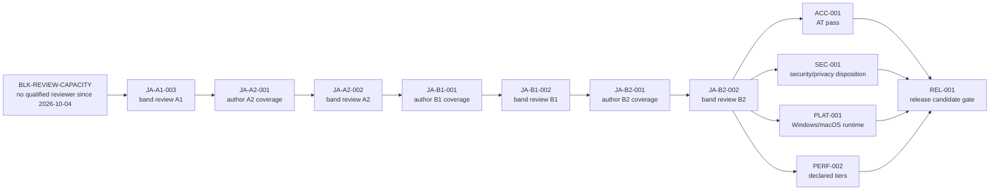

# Owner checklist — 2026-10-16

Everything an agent may execute is executed. Both reference packs are published at **0.4.1** and
immutable, and the working tree at `HEAD` contains every agent-side follow-up: publication records,
the media-in-git exception removal (D4), the `zip` bump (D8b), the CI records, this checklist, its
two review packets, and the stale-doc corrections to both 2026-10-14 worklists and
`scripts/build-catalog.sh`. CI status per run is recorded in `tasks/KANBAN.md` (`ci-green-main`).

This file is the part only you can do. Nothing here is marked done; the human checks stay open
(§7). Companion detail lives in `state/evidence/OWNER-CHECKLIST-2026-10-16/`.

---

## 1. Seven ADRs still say `Proposed` — your call, one line each

ADR-0027 is already `Accepted`. These seven are not. Line 3 is yours; an agent may add
Applied/Executed paragraphs below it and never touches it (`AGENTS.md`, `docs/15`).

| ADR | what it decides, in plain English | already true in the code? | my recommendation |
| --- | --- | --- | --- |
| **0026** profile without an active pack | A profile may exist with no language pack chosen. The wizard offers every pack already on the device, not just the compiled-in ones; opening a profile never depends on reading pack content; content commands still refuse with one fixed token rather than lying with an empty list. | Yes. `available_packs_at`, `complete_onboarding(Option<String>)`, `resumeProfile` in `apps/desktop/src-tauri/src/lib.rs` / `App.tsx`; `home.test.tsx` covers the no-pack Home. | **Accept.** This is the behaviour you directed in chat on 2026-10-12; the code matches it. The ADR contains no unproven claim. |
| **0028** licence-permissiveness detection | The pack audit compares a declared licence with the licences of the sources it is derived from, at two levels (record and manifest), but only for Creative-Commons ids, and never for `reference-only` sources. The finding is `Info`, not a gate. | Yes. `crates/langpack/src/audit.rs`, code `license_less_permissive_than_source`; it caught the real ja-JP `CC-BY-4.0`-over-CC-BY-SA defect, and that defect is now closed (manifest and catalogue both say `CC-BY-SA-4.0`). | **Accept at `Info`.** Do not promote it to Warning/Error: `lint` fails on warnings and `test` on errors, so gating would push pack authors to delete licence records instead of fixing licences. The tool deliberately states no opinion on non-CC ids. |
| **0029** RTL direction model | App chrome stays left-to-right; every run of pack-sourced text carries its own `dir`/`lang` taken from the pack's manifest; romanisation and Latin glosses are the only hardcoded directions. | Yes. `packages/ui/src/pack-direction.tsx`, `PackText`/`usePackTextAttrs` across `practice.tsx`, `reading.tsx`, `dictation.tsx`, `writing.tsx`, `scenario.tsx`; `manifest_rtl` in `lib.rs`; tests `rtl-direction.test.tsx`, `pack-direction.test.tsx`. | **Accept with one stated caveat:** no RTL pack has ever been installed and looked at by a human (`examples/ar-ma` is an example pack), and `catalog/packs.json` carries no `rtl` field, so a catalogue row's display name renders in document direction until the catalogue grows the flag. |
| **0030** attempt identity and disqualifying support | Repetition of one task is one observation, not two; a sitting is identified by a session id the app supplies; and support that supplies the assessed construct (transcript, romaji substitution, supplied reading) disqualifies credit for that dimension. The disqualifying list is data in `docs/assessment/MASTERY_POLICY.yaml`, not Rust. | Yes. `Policy::observations()` (`prompt_family_id.or(activity_id)`), `planSessionRef` in `App.tsx`, scenario `session_id`, `policy_version: "0.2.0"` with `support.disqualifying_for` at `MASTERY_POLICY.yaml:69-74`. | **Accept.** It fixes measured defects R03/R04 and re-derives without migrating append-only evidence. Numeric thresholds stay provisional under D9; that is separate from accepting the identity model. |
| **0031** goal prerequisites aggregate over declared concepts | A prerequisite that names a *goal* is satisfied by the weakest of that goal's declared concepts; a goal declaring no concepts is never satisfied; prerequisites naming content keep the old lookup. | Yes. `goal_derived_state` (`lib.rs:1755`), `prereq_satisfied` (`lib.rs:1781`). The Russian half is in the pack: `ru.goal.on-ramp.cyrillic` now declares `required_concepts`, and `curriculum/units/010-cyrillic-a-o-m-t.yaml` declares `script-introduction`. | **Accept**, and add the human follow-up: a fresh Russian profile used to be locked out of the on-ramp path entirely (54 ja / 170 ru unsatisfiable edges). Verify that path once by hand during the O-06 sweep. |
| **0032** pack media that outruns the published archive | A bounded exception: 18 journey `.wav` bytes ride in git, with named `.gitignore` negations, until the packs are republished; then the exception is deleted and the bytes come from the published archive. | Executed 2026-10-16. 0.4.1 published, exception and its 18 negations deleted, `fetch-pack-audio.sh --verify-only` ja 4,902 / ru 4,856 rows, 0 failing. | **Accept and close it** — the mechanism no longer exists. An `Executed 2026-10-16` paragraph is already in the file; the line-3 flip should say the exception is deleted, not that it is proposed. |
| **0033** explicit ledger records for release-path tasks | Every roadmap task flagged `required_for_desktop_1_0` must have an explicit `state/task-state.json` record; the validator flag `--require-explicit-ledger-records` makes absence a named failure; `blocked` is the honest home for "an agent cannot finish this". | Yes, and it is already **load-bearing**: D5b turned the strict flag on in CI, so today's builds fail if a required card lacks a record. | **Accept — or switch the CI flag back off.** Leaving it `Proposed` while CI enforces it is the inconsistency; the policy itself is sound and is what keeps the eight human-gated cards visible. |

Suggested line-3 text (edit, do not paste blindly):

```
ADR-0026: Status: Accepted — owner decision 2026-10-16; behaviour directed in chat 2026-10-12 and implemented as described.
ADR-0028: Status: Accepted at Info severity 2026-10-16 — no promotion to Warning/Error without a further owner decision.
ADR-0029: Status: Accepted 2026-10-16 — no RTL pack has been installed and human-reviewed; the catalog carries no rtl field.
ADR-0030: Status: Accepted 2026-10-16 — numeric thresholds remain provisional (queue item D9).
ADR-0031: Status: Accepted 2026-10-16 — fresh-profile Russian on-ramp path still needs one human verification pass.
ADR-0032: Status: Accepted 2026-10-16; exception executed and deleted the same day (queue item D4), so the ADR is historical.
ADR-0033: Status: Accepted 2026-10-16 — the strict validator flag is enabled in CI (queue item D5b).
```

---

## 2. Owner hands-on pass — O-06

Full runbook: `docs/21_HUMAN_REVIEW_RUNBOOKS.md` Runbook B. What follows is the ordered version
with today's corrections folded in.

1. Close the running app first. `lts-desktop` holds a Tauri single-instance lock, and your vite on
   `127.0.0.1:1420` blocks the headless smoke path.
2. Build and launch on the Gaming PC:
   ```sh
   source scripts/tauri-env.sh
   cargo build -p lts-desktop
   scripts/launch-preview.sh        # starts its own vite for build.devUrl
   ```
   (GamingPC has no pnpm; `pnpm tauri dev` is the Hermes-worker path only.)
3. Optional machine leg, only when port 1420 is free:
   ```sh
   LTS_SMOKE_TIMEOUT=900 scripts/smoke-desktop.sh    # expect: SMOKE OK (13 routes walked)
   ```
   It uses `xvfb-run` and a throwaway `LTS_DATA_DIR`; it fails unless a scenario started, the mic
   picker exists, the fresh plan is non-empty, and the pack-install stages appear.
4. **The pack-update path is now part of this run.** Your store still holds 0.2.0.
   Settings ▸ Language packs renders **`Update to v0.4.1`** whenever the installed version differs
   from the pin (`apps/desktop/src/language.tsx:419-429`, fed by `packs.rs:238-241`), so click it,
   watch the receipt line ("Installed *pack* v0.4.1 — this is what was verified…"), and confirm the
   old version stays in the store for rollback. ~319 MB per pack, ~637 MB for both; **time it** —
   no install-duration number exists in the repo, and the 900 s in CI is a walkthrough window, not
   an install.
5. Work the checklist in `state/evidence/O-06-2026-10-10/owner-report.md:76` — five-tab nav and hub
   drill (findings 1–2), Settings ▸ Profile data → Switch profile (9), Speech cards split and the
   Playback output section (10: a picker *or* the honest "system sound settings decide" sentence —
   both are correct, report which you saw), active-pack switch plus listening to the
   loudness-normalised audio and tap-lookup なまえ in 「私の名まえは何ですか」 (5/6/11), Shadowing
   controls and the scenario ladder/transfer variants (7/8), K-81 nav sign-off.
6. Re-probe the two open content items: the "echoey, metallic, tinny" character of reference audio
   (finding 11/12 — the Qwen3-TTS re-bake is done, so this is now a listening judgement), and the
   `Start with speech` gate, which now requires an installed *recognition* component only
   (`onboarding.test.tsx:255`).
7. Add two findings the code tells you to expect:
   - the wizard's install check is **version-blind** — `App.tsx:266,842` keep `installedPacks` as
     pack ids and `onboarding.tsx:95,200,205` gate on `installedPacks.includes(pack_id)`, so a
     0.2.0 install reads as `Installed` in the wizard with no upgrade hint. That is
     `PACK-UPDATE-UX-001`, not a new bug;
   - the fresh-profile Russian on-ramp path (ADR-0031) used to be unreachable; check a new ru
     profile actually gets Cyrillic-first instruction.
8. Record it: a dated copy of that report under `state/evidence/O-06-2026-10-16/`, then tick the
   relevant issue #1 boxes and let the board row `O-06` be annotated. Do not tick R12, R13, I04,
   I05 or I08 — those need their own evidence.

---

## 3. Screen-reader and IME pass — O-03 → ACC-001

Full worksheet: `docs/assessment/ACCESSIBILITY_AUDIT.md`; runbook: `docs/21` Runbook A. Only the
Linux/Orca row blocks the desktop RC; the Windows/macOS rows stay empty until someone has those
machines. Run it with **0.4.1 installed**, so the 18 journey clips are present in the pack.

1. Install the AT stack on the test desktop (the Gaming PC has none — `orca`, `espeak-ng`, `ibus`
   are all "command not found" there): `orca`, a Japanese-capable voice (`espeak-ng` ja voice or
   better), `ibus` plus Mozc or Anthy.
2. Pin the environment, one row per run, never "latest":
   ```sh
   git rev-parse HEAD
   pkg-config --modversion webkit2gtk-4.1
   PKG_CONFIG_PATH="$HOME/.local/opt/tauri-sysroot/usr/lib/pkgconfig" pkg-config --modversion webkit2gtk-4.1
   orca --version ; espeak-ng --voices=ja | head -3
   ibus version 2>/dev/null || busctl --user get-property org.freedesktop.IBus /org/freedesktop/IBus org.freedesktop.IBus.Version
   ls /usr/share/ibus/component/ | grep -i "mozc\|anthy"
   ```
   Record **both** WebKitGTK numbers — the system pkg-config and the sysroot the app links against
   (2.54.1 vs 2.52.6 on the Gaming PC) — and which one a bundle was built against.
3. If you test a packaged deb, run `./scripts/finalize-deb.sh <the.deb>` first: the generated
   `Depends: … libgtk-3-0` no longer installs on Ubuntu 24.04 / Debian 13, and the script rewrites
   it to `libgtk-3-0t64 | libgtk-3-0` while proving nothing else changed. Record which build you
   finalized — finalizing changes the package digest.
4. `source scripts/tauri-env.sh` then `RUST_LOG=info pnpm tauri dev 2> state/evidence/ACC-001/run-L1.log`
   (or the pnpm-free `scripts/launch-preview.sh`), with Orca up and `ibus-daemon -drx` + Mozc, and
   test each condition separately: screen-reader only · keyboard-only · 200% zoom ·
   `prefers-reduced-motion: reduce`.
5. Walk the 14 journeys in the audit matrix (`:63-78`). Every row is HUMAN-ONLY: what Orca actually
   said is the observation. For surfaces that changed since the worksheet was written, the reader
   must hear: the single `Start today's plan — {N} activities…` action; section `Today's session`;
   section `Session summary` with "Session stopped after {done} of {total} activities."; section
   `What you can do now`; section `Goal map` with heading "Capabilities you are building".
6. Journeys 4 (Dictation) and 5 (Writing) are the IME-critical ones: candidate-window placement,
   `Escape` cancelling composition rather than clearing the field, `Enter` committing a conversion
   instead of submitting. If they fail, file the defect with the exact engine version — a webview
   composition bug is not fixable in this app, and a kana-only + romaji fallback is a product
   decision, not a bug fix.
7. Furigana test, unchanged and HUMAN-ONLY: for a kanji word with a reading, record whether Orca
   says headword-then-reading (acceptable), the reading twice (defect), or nothing for the reading
   (defect). The markup claim in the worksheet is stale — `apps/desktop/src/ruby.tsx` now emits real
   `<ruby>/<rt>/<rp>` (contract-tested in `ruby.test.tsx`), no sibling `<small>` line.
8. Per failure record: route, component/file, what Orca said, what it should have said, condition.
   No audit-only workarounds; nothing may be marked "as designed" that an AT user cannot perceive.
   Then fill the sign-off table at `ACCESSIBILITY_AUDIT.md:107-113`, including your AT expertise
   level. An incomplete matrix does not block development, but no release may claim accessibility
   conformance beyond the signed rows.
9. Windows row (W1) needs NVDA + WebView2 + Microsoft IME Japanese; macOS row (M1) needs VoiceOver +
   WKWebView + macOS Japanese input. Both need the built bundles, and `platform-bundles` only runs
   on `workflow_dispatch` — dispatch it from the Actions page if you want bundles to install.

Already machine-proven, so do not spend your time re-checking it: the route-change focus effect and
the keyboard journey (`apps/desktop/src/a11y.test.tsx` is K-33's matrix; `A11Y-FLOW-001`'s mounted
journey test asserts the focus target at every stop), and the session/progress copy snapshots
(`journeys/session.journey.tsx`, `journeys/progress.journey.tsx`).

---

## 4. What a qualified language reviewer actually needs

Source of truth: `languages/ja-JP/review/REVIEW_POLICY.yaml` (`policy_version: 1.0.0`,
`status: agreed-owner-2026-10-04`) and `languages/ru-RU/review/REVIEW_POLICY.yaml` (same shape,
`native_russian` / `near_native_russian_documented`).

Three review types need a human, and each needs **two** things — one from the language column, one
from the skill column (`required_any` + `required_also_any`):

| type | judges | required_any | required_also_any |
| --- | --- | --- | --- |
| linguistic (`:31-42`) | naturalness, meaning, grammar, readings, accepted variants, register, translation adequacy, distractor plausibility | `native_japanese` / `near_native_japanese_documented` | `japanese_linguistics_training` (incl. phonetics) / `japanese_language_teaching_credential` |
| pedagogical (`:43-53`) | difficulty, prerequisite load, task validity, scaffolding, distractor quality, transfer value | `language_teaching_experience_documented` / `curriculum_or_assessment_design_experience` | `native_japanese` / `near_native_japanese_documented` |
| technical (`:54-60`) | rendering, audio linkage, speech targets, determinism; listening to real audio in lesson context | `project_technical_reviewer` (maintainer-authorized engineer) | `native_japanese` / `near_native_japanese_documented` |

The load-bearing line: **"native/near-native status alone does not qualify"** (`:42`). A fluent
volunteer is a `community-reviewer`, not a qualified reviewer.

What a reviewer may promote (`:109-119`, kit `:44-51`):

- `community-reviewer` → at most `validated`.
- `qualified-human-expert` / `qualified-human-native-speaker` → `verified`.
- `ai-assisted` and `automated-check` → never promote; AI may promote only to `screened`.
- `draft → screened` is machine-only; `screened → reviewed` needs qualified records for the item's
  scope; `reviewed → verified` needs all review types complete, no unresolved P0/P1, and a
  source/licence audit pass.
- **You cannot substitute self-review**: `promotion_authority.owner` may promote to `reference` only
  when coverage gates pass, and "may NOT substitute self-review for qualified review" (`:119`).
  `:192-193` is explicit: the owner is a learner, not a qualified reviewer. That is why
  `BLK-REVIEW-CAPACITY` has been open since 2026-10-04.

Mechanics a reviewer must follow or CI rejects the PR:

1. Fork, review a batch, open **one PR** that both adds `languages/<pack>/reviews.jsonl` line(s)
   and flips the reviewed items' `status` from `draft`. A bare status flip fails the validator
   (`review_promotion_unsupported`). Neither pack has a `reviews.jsonl` yet — the first review PR
   creates it.
2. Record fields: `reviewer`, `reviewer_category`, `scope`, `date`, `outcome`, `notes`, `evidence`
   (`schemas/v0.2/review-record.schema.json`). Overstating `reviewer_category` is the one failure
   mode this schema exists to catch.
3. Severity P0 materially wrong instruction / P1 major path broken / P2 localized defect /
   P3 cosmetic (`languages/ru-RU/review/REVIEWER_KIT.md:68-74`). Any unresolved P0/P1 blocks
   promotion. `changes-requested` and `rejected` are valuable records, not failures.
4. 100% qualified review is required for scored targets and assessment items, reused core
   instructional content, target readings and reference audio, and coverage-map objective
   statements; stratified sampling (≥25% or 20 items per stratum, seed recorded) is allowed only for
   unscored generated practice variants, and those stay labelled unreviewed (`:65-77`).

Workload you are handing someone (all numbers measured today):

| queue | size | what |
| --- | --- | --- |
| `docs/review/worklists/ja-JP-2026-10-05.jsonl` | 964 rows (gloss-divergence 684, not-in-jmdict 280) | lexicon-level review |
| `docs/review/worklists/ru-RU-2026-10-05.jsonl` | 534 rows (stress-unverified 316, pos-low-confidence 85, feature-undetermined 81, plural-only-noun 43, gender-conflict 9) | lexicon-level review; Zalizniak 6th ed. auto-verifies 3,684/4,000 readings, and inherent `ё` without a combining mark is correct, not a defect |
| `languages/ja-JP/review/WORKLIST-2026-10-14.md` | 81 lines — goals `ja.goal.b1.work-professional`, `ja.goal.b2.film-analysis` | the R12 batch, all `draft` |
| `languages/ru-RU/review/WORKLIST-2026-10-14.md` | 90 lines — goals `ru.goal.a2.past-events`, `ru.goal.b1.practical-problems`, `ru.goal.b2.style-register` | the R12 batch, all `draft` |
| band review cards | `JA-A1-003`, `JA-A2-002`, `JA-B1-002`, `JA-B2-002`, all `blocked` | one record per band per named pack version; ru has no band cards, its queue is the kit + worklist |
| 18 new clips | 8 ja + 10 ru | listening judgement, §5 below |

Recruitment (from the kits, none engaged yet): university Japanese/Russian programmes as practicum
work; explicit "volunteer qualified reviewer" calls in learning communities, with the categories
above verified rather than self-claimed; paid review via translation/education marketplaces — the
last one needs your budget authorization.

---

## 5. Catalogue and Russian content, prepared for your review

### 5a. Catalogue (`catalog/packs.json`)

The tracked file and the machine-generated candidate for the exact published archives agree on
**every pack-level field**. The candidate is `dist/rc-0.4.1/packs.json` (built 2026-10-16 08:20 from
the archives that were uploaded); the diff against the tracked file is only prose and ordering:

| field | tracked = generated? | where the generated value comes from |
| --- | --- | --- |
| `version`, `url`, `sha256`, `size_bytes` | identical (0.4.1, 318,722,747 / 318,489,935, digests `e697ee92…4690` / `9eb074fa…1d7a`) | measured off the built archive |
| `license` | identical — ja `CC-BY-SA-4.0`, ru `CC0-1.0` | the pack's own `manifest.yaml:33` / `:30` |
| `display_name` | identical — "Japanese Reference Pack", "Russian Reference Pack (Draft)" | `manifest.yaml:3` |
| `review_status: community` | identical | derived from pack maturity: `reference/certified/reviewed` → `reviewed`, else `community` (`crates/langpack-cli/src/main.rs:1246`) |
| `min_sdk_version: 0.1.0` | identical | manifest `engine.min_version`, default `0.1.0` (`:1247`) |
| `tested_platforms: ["linux"]`, `community_confirmed_platforms: []`, `untested_platforms: ["windows","macos"]` | identical | carried through untouched; report records can **never** populate `tested_platforms` (`:695-699`), which is the ADR-0015 rule enforced in code |
| `catalog_version` | differs: generated `"1"` vs tracked `"0.1.0"` | hand-set in the tracked file |
| root `note` and `platform_note` | differ: the generated file has only a one-line note | hand-authored prose in the tracked file |

Full field-by-field packet, with the exact derivation line for each value:
`state/evidence/OWNER-CHECKLIST-2026-10-16/catalog-review-packet.md`.

Two facts to hold onto before you run anything:

- `scripts/build-catalog.sh` writes **`dist/preview/packs.json`** only (gitignored); merging into the
  tracked file is owner gate O-05 (`:55-56`). But `langpack catalog` itself rewrites whatever
  `--file` you hand it (`crates/langpack-cli/src/main.rs:1169-1181`), and a fresh draft carries
  `catalog_version: "1"`, a one-line note, **no** `platform_note`, and two extra entries
  (`tests/fixtures/packs/{ja-demo,eo-demo}`, `scripts/build-catalog.sh:43-46`). Pasting a draft over
  the tracked file silently deletes your prose.
- The candidate above is reproducible **only** because it was built from the bytes you uploaded.
  `sha256`/`size_bytes` are measured off freshly built archives (`main.rs:1249-1250`) and synthesis is
  not byte-reproducible (`docs/13_RELEASE_AND_DISTRIBUTION.md:419-421`); a fresh checkout has no
  `.wav` bytes at all. So a regeneration is a pack change — new digests, new version, a catalogue that
  no longer describes 0.4.1 — and is never a way to "re-derive" the published pins. Cross-check
  against the live host instead, any time:

```sh
gh release view org.openlanguage.ja-jp.reference-0.4.1 --json tagName,isImmutable,targetCommitish,url,assets \
  -q '[.tagName,.isImmutable,.targetCommitish,.url,(.assets[]|[.name,.size,.digest,.state])]'
gh release view org.openlanguage.ru-ru.reference-0.4.1 --json tagName,isImmutable,targetCommitish,url,assets \
  -q '[.tagName,.isImmutable,.targetCommitish,.url,(.assets[]|[.name,.size,.digest,.state])]'
```

Both read back `isImmutable: true`, target `20f994df05478f92b9d2399bbf655066e21ffda6`, assets
`uploaded` with the digests above. Raw output saved in
`state/evidence/OWNER-CHECKLIST-2026-10-16/gh-readback-*.txt`.

### 5b. Russian content with no human verdict

Between the 0.4.0 tag (`70ec683`) and the published 0.4.1 tree (`20f994d`), ru gained:

| file | added lines | what |
| --- | --- | --- |
| `curriculum/goals.yaml` | 68 | the A2/B1/B2 goal edges and required concepts behind the R12 batch |
| `curriculum/units/810…818` (9 new units) | 76, 70, 72, 77, 71, 71, 72, 75, 75 | the a2/b1/b2 journey units themselves |
| `curriculum/units/010-cyrillic-a-o-m-t.yaml` | 2 | the `script-introduction` capability ADR-0031 required |
| `grammar/concepts.jsonl` | 4 | the two new grammar sets the journey units rest on |
| `sentences/journeys-2026-10-14.jsonl` | 10 | the journey sentences that the 10 ru clips speak |
| `media/manifest.jsonl` | 10 | the bake rows for those clips |
| `world/environments.jsonl` | 3 | the three new environments |
| `review/WORKLIST-2026-10-14.md` | 90 | the reviewer worksheet for this batch |
| `manifest.yaml` | 1 | the `0.4.1` version bump |

Between `20f994d` and `HEAD` **nothing** ru-content-wise: the only ru changes after the published
tree are the 10 `.wav` files leaving git (queue item D4). Full numstat:
`state/evidence/OWNER-CHECKLIST-2026-10-16/git-ru-040-to-041-numstat.txt`.

Packet with every number and its source line:
`state/evidence/OWNER-CHECKLIST-2026-10-16/ru-content-review-packet.md`. The state you are approving,
measured today:

- **Zero human provenance work accompanied it.** `git log 70ec683..HEAD --
  languages/ru-RU/licenses.jsonl languages/ru-RU/sources.jsonl` is empty while 847 content lines
  landed; `licenses.jsonl` is still one row, `sources.jsonl` two.
- **Every media row says it is unreviewed**: "AI output, not a human recording and not
  human-reviewed" appears in 4,856 ru and 4,902 ja manifest rows, including the ten clips now inside
  the immutable 0.4.1 archive. No human has listened to them, and there is no undo.
- **Depth behind the new surface**: 818 ru units (on-ramp 20, A1 90, A2 102, B1 203, **B2 403**), 60
  goals; **763 units** cite only the two on-ramp grammar concepts (A1 64, A2 99, B1 200, B2 400).
- **The worklist is entirely open** — `languages/ru-RU/review/WORKLIST-2026-10-14.md` has 0 checked
  boxes and says at `:95-96` that review artefacts "remain open for every id above". Its
  bake-obligation section (`:74-89`) was rewritten in this pass because its facts had gone stale at
  0.4.1; the review items themselves are untouched.
- **Maturity unchanged**: `languages/ru-RU/manifest.yaml:10` is `maturity: "experimental"`, every new
  sentence row is `status: "draft"` with "ai-drafted; human review required".
- **What the green audits do not mean**: `validate_handoff.py` ends with a WARN that linguistic
  correctness, source rights and calibration quality remain unverified, and
  `tools/audit_learner_copy.py` scans only `*.ts`/`*.tsx` under `apps/desktop/src` and
  `packages/ui/src` — it can never report anything about pack content, so its "0 findings" is not
  evidence about these sentences.

Playing the 10 ru (and 8 ja) clips from a plain checkout — they are no longer tracked, they come
from the published archive:

```sh
git ls-files 'languages/*/media/*.wav' | wc -l          # 0
./scripts/fetch-pack-audio.sh --pack-dir languages/ja-JP --work-dir tmp/pack-audio
./scripts/fetch-pack-audio.sh --pack-dir languages/ru-RU --work-dir tmp/pack-audio
./scripts/fetch-pack-audio.sh --verify-only --pack-dir languages/ja-JP   # rows checked=4902 failing=0
./scripts/fetch-pack-audio.sh --verify-only --pack-dir languages/ru-RU   # rows checked=4856 failing=0
```

Structural repetition, same tool CI runs (`python3 tools/audit_content_templates.py languages/ja-JP
languages/ru-RU`, exit 0): ja 831 sentences / 792 units, **92 findings** (e.g. skeleton `_ _`
repeated 53× in a1); ru 825 sentences / 818 units, **35 findings**. It measures repetition only and
claims nothing about CEFR level or pedagogical validity. The specific reason a ru B2 verdict must
not be waved through: ru `b2` = 400 units riding on one 2-element grammar set with the `это _`
skeleton 400 times (`UPPERBAND-TASK-JOURNEYS-001`).

Three ru questions the audio reopened, waiting on a reviewer, not on code
(`languages/ru-RU/review/WORKLIST-2026-10-14.md:66-72`): the three new environments were kept at
`recall-meaning` on the ground that no audio existed — audio exists now, so a reviewer must say whether
they become `comprehension-listening`. Per-sentence checks are at `:24-33` (`гулял` gender, the
`неполадку` four-case cloze chain, `опечаток` genitive plural).

`tmp/fix-ru-stress.py` is yours to run, rewrite or delete: I have not run it, moved it or deleted
it. I did measure it, by running a byte-faithful copy with its single write call replaced by a no-op:
`ru entries: 4015, readings changed: 1`. The one row is
`languages/ru-RU/lexicon/narration.jsonl:4` (`ru.lex.narration.totchas`), which would go from
`тотча́с` to `то́тча́с` — matching the pinned Zaliznyak headword
(`tmp/zaliznyak/dictionary/Нарицательные/С.txt:81`) while contradicting that row's own note that its
stress was already "verified against zalizniak-2010 (2026-10-05)". Whether a learner reading should
carry that secondary stress is a Russian-speaker's call, and adopting it is a pack change (new
version), not a patch. Full reasoning and the licence position:
`state/evidence/OWNER-CHECKLIST-2026-10-16/ru-content-review-packet.md` §5.

---

## 6. What should block the release, and what should not

The required set is 66 cards; **8 are not `done`**, and they are not eight independent problems.
Six of them hang off one root — no qualified reviewer has been engaged since 2026-10-04:



| card | blocker class | my recommendation | why |
| --- | --- | --- | --- |
| **ACC-001** | external + human | **Keep as a hard blocker.** | D7: you will schedule it. A release that ships a screen-reader-broken dictation/writing flow fails the product's own accessibility non-negotiable, and the audit forbids claiming conformance beyond signed rows. Only the Linux/Orca row gates the desktop RC — that is one machine plus one AT user. |
| **SEC-001** | human disposition | **Keep as a hard blocker.** | It is not the dependency scanners: those pass (3 allowed warnings, exit 0). What is missing is a consolidated malicious-pack suite, a privacy review of provider upload paths, and a logging/retention gate. Accepting residual risk is a human act, and it is cheap to do once. |
| **RELEASE-EVIDENCE-001** | human | **Keep as a blocker, and make it the last 30 minutes of the gate.** | "Evidence measured from the artifact" is what stops a release claim resting on a dev build. It depends on ACC-001 + SEC-001, so it closes with them. |
| **`JA-KANJI-ATTRIBUTION-001`** (currently optional) | agent-executable, owner-gated | **Recommend you *add* it to the gate before public distribution.** | EDRDG's CC BY-SA acknowledgement is a licence duty and `apps/desktop/src` renders no pack attribution at all. Shipping publicly with an unmet ShareAlike attribution is a compliance exposure, not a nice-to-have. It is small, agent-buildable, and should ride before distribution. |
| **PLAT-001** | external (hardware/spend) | **Do not block on it — record the scope decision instead.** | ADR-0015 already encodes the honest posture: `tested_platforms: ["linux"]`, `untested_platforms: ["windows","macos"]`, and the CLI refuses to let a build or a report populate `tested_platforms`. Bundles are produced and labelled untested. Keeping the label honest costs nothing; buying machines or paid runner minutes is your spend decision, and D15's `community_confirmed_platforms` path gives you a non-purchase route via runtime reports. |
| **PERF-002** | provisional data + external | **Partial blocker: require the `typical` tier only.** | D9 keeps budgets provisional and only `typical` is measured. Blocking 1.0 on three tiers while the hardware list doesn't exist stalls the release on a document; blocking a *performance claim* on the measured tier is the meaningful version. |
| **The band-review chain** (`JA-A1-003 → … → JA-B2-002`, plus `JA-A2-001/B1-001/B2-001`) | qualified human | **Do not let it block a labelled-draft release; do let it block any completeness claim.** | `REVIEW_POLICY.yaml:120-125` gives you the recorded lever: `accept_draft_labeling_at_release` — content ships labelled draft/unreviewed and band-completeness claims are forbidden. That is already the shipped posture (everything in the R12 batches is `draft`), and D10 kept qualified review out of the required set. The chain only becomes a blocker the moment you want the pack called reviewed. |
| **18 AI-baked clips now frozen in published releases** (10 ru in 0.4.1, 8 ja in 0.4.0) | human listening | **Cannot block 0.4.1 retroactively; make it a gate on the next pack version.** | Every row of both `media/manifest.jsonl` files states "AI output, not a human recording and not human-reviewed" (4,856 ru / 4,902 ja) and nobody has listened. Because releases are immutable, a bad clip can only be fixed by a new version — and any re-release re-verifies every declared asset (`media_asset_missing`, `crates/langpack/src/audit.rs:994`) and rebuilds the archive (`crates/langpack/src/archive.rs:97` refuses absent declared media). The cheapest listening pass is the one before the next bake. |
| **`PACK-UPDATE-UX-001`**, `JA-KANJI-DECOMP-UI-001`, `JA-KANJI-REFRESH-001`, `UPPERBAND-TASK-JOURNEYS-001`, `RU-MODALITY-PRACTICE-001`, `A11Y-FLOW-001` (human half), `SPEECH-007`, `TTS-003` | mixed | **Do not add to the gate.** | The update affordance already exists in Settings ▸ Language packs; the drill-display rule is copy work; the refresh procedure is a duty with a date, not a gate; upper-band depth is exactly what the review chain is for. Keep them as the post-1.0 queue. |

Practical consequence: the shortest path to a defensible desktop RC is **(1)** one AT user on one
Linux box, **(2)** your security/privacy disposition, **(3)** the pack-attribution surface,
**(4)** evidence re-measured from the artifact — and an explicit, recorded decision that the
Russian and Japanese content ships labelled unreviewed, with no completeness claim.

---

## 7. Kept open (nothing here is marked done)

| item | state |
| --- | --- |
| ACC-001 / O-03 Linux + Orca pass | open, `blocked`; you schedule it (D7) |
| O-06 hands-on pass | open |
| `JA-A1-003`, `JA-A2-002`, `JA-B1-002`, `JA-B2-002` | open, `blocked` on a reviewer; `BLK-REVIEW-CAPACITY` open since 2026-10-04 |
| ru lexicon + R12 review queue | open, no reviewer engaged; no ru band cards exist, so the ru queue is the kit + worklists |
| SEC-001 disposition, `RELEASE-EVIDENCE-001` | open, `blocked` |
| PLAT-001 runtime reports, PERF-002 tiers | open, `blocked` |
| ADR-0026, 0028, 0029, 0030, 0031, 0032, 0033 `Status:` lines | open (§1) |
| Issue #1 checkboxes R12, R13, I04, I05, I08 | open, untouched |
| `A11Y-FLOW-001`, `INSTALL-UX-001`, `CANDO-PROGRESS-001`, `GUIDED-SESSION-001` | `review` — agent-built, human acceptance open |
| `ru.lex.narration.totchas` stress (`тотча́с` vs Zaliznyak's `то́тча́с`) | open, one row, §5b |
| Three ru environment modality decisions (`recall-meaning` → `comprehension-listening`?) | open; the audio reason no longer exists |
| `catalog_version`, ru `display_name` "(Draft)" | open cosmetic calls, §5a; nothing machine-generated needs changing |
| Listening pass for the 18 shipped AI clips | open, §6; only fixable through a new pack version |
| `tmp/fix-ru-stress.py`, `scripts/build-catalog.sh` regeneration | owner-only; never run (blast radius measured by a write-free copy, §5b) |
